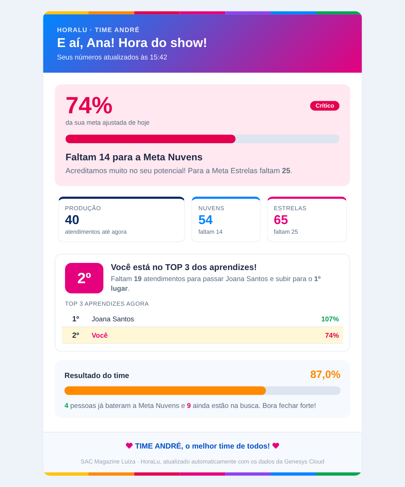

# HoraLu

Automação em **Google Apps Script** que lê os relatórios agendados da **Genesys Cloud** no Gmail, consolida as métricas numa planilha Google e envia, a cada atualização, e-mails com o desempenho do dia para os agentes e para a gestão do SAC.

  
  
  

> As prévias usam dados fictícios.

## Como funciona

1. A Genesys envia por e-mail os relatórios em CSV (performance, ociosidade e avaliações).
2. Um gatilho do Apps Script procura esses anexos no Gmail, identifica cada CSV pelo cabeçalho e importa para as abas `RAW_*` da planilha.
3. O script calcula, por agente: produção, meta ajustada pela ociosidade, % da meta, CSAT, RPC e a **Nota HoraLu**, que ordena o ranking.
4. Envia os e-mails:
   - **Agente**: as próprias metas (Meta Nuvens = 100% da meta ajustada, Meta Estrelas = 120%), sua posição e quanto falta para subir no TOP 5.
   - **Aprendiz**: mesma ideia, com ranking TOP 3 entre aprendizes.
   - **Gestão**: painel completo do time (atingimento, pódio, quem precisa de ajuda, qualidade, ranking completo).

Regra de privacidade: o e-mail de agente e aprendiz **não traz nome, métricas nem metas dos colegas**. O placar mostra só as posições; os dados dos outros nem entram no HTML. Só a gestão vê tudo.

### Nota HoraLu

`70% produção (% da meta ajustada, limitada a 120%) + 15% CSAT ÷ meta + 15% RPC ÷ meta`

- CSAT = promotores ÷ respostas (meta 92%)
- RPC = "sim" ÷ respostas (meta 82%)
- Com menos de 3 avaliações, o indicador conta como na meta.

## Estrutura

| Pasta | Conteúdo |
|---|---|
| [`time-andre/`](time-andre/) | Versão atual (time do supervisor André): [`HoraLu_Andre.gs`](time-andre/HoraLu_Andre.gs), [passo a passo de implantação](time-andre/IMPLANTACAO.md) e [prévias dos e-mails](time-andre/previas/). |
| [`time-vitor/`](time-vitor/) | [Versão original](time-vitor/HoraLu_Vitor_original.gs) do HoraLu, criada para o time do supervisor Vitor. |

## Instalação rápida (versão do time André)

1. Na planilha: **Extensões > Apps Script**, cole o conteúdo de `time-andre/HoraLu_Andre.gs` e salve.
2. No bloco `CFG` no topo do código, preencha `EMAIL_GESTOR`, `EMAIL_COORDENADORA` e `EMAIL_TESTE` (no repositório estão como `@exemplo.com.br`).
3. Na aba `AGENTES`, confira os e-mails dos agentes (coluna G) e marque `OK` (coluna H).
4. Recarregue a planilha e use o menu **HoraLu** para processar, testar e instalar o gatilho.

Detalhes completos em [`time-andre/IMPLANTACAO.md`](time-andre/IMPLANTACAO.md).

### Planilha esperada

Abas: `BASE_CONSOLIDADA`, `AGENTES`, `CONFIGURAÇÕES`, `RANKING`, `Dashboard`, `RAW_PERFORMANCE`, `RAW_OCIOSIDADE`, `RAW_AVALIACOES`, `CONSOLIDADO_AVALIACOES`, `HISTÓRICO` e `LOG` (criada automaticamente).

## Observações

- O gatilho precisa ser instalado na conta Google que **recebe** os relatórios da Genesys, porque o script lê o Gmail de quem o executa.
- Nenhum e-mail real, ID de planilha ou credencial está neste repositório. Os endereços foram trocados por exemplos.
