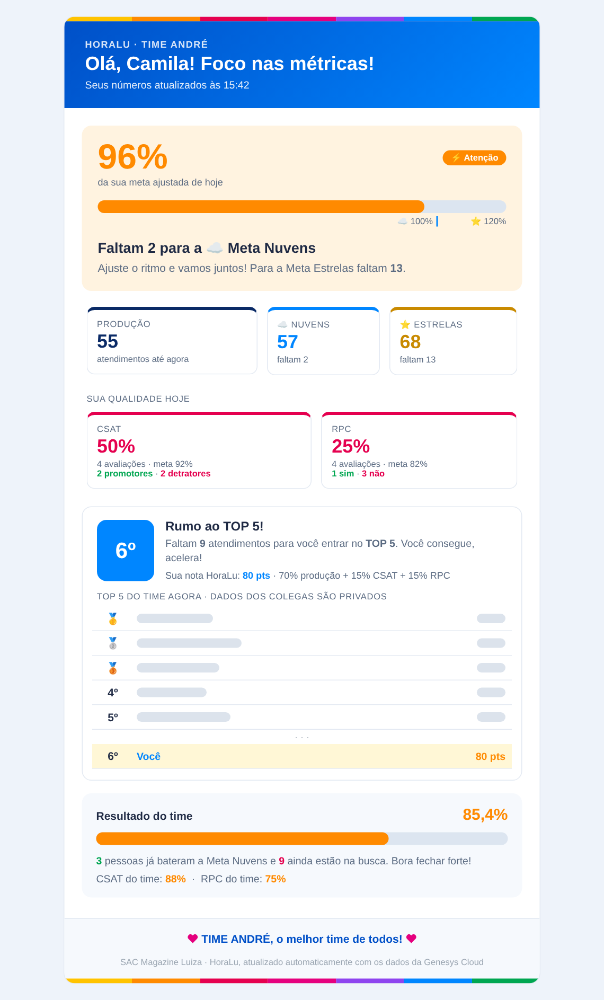
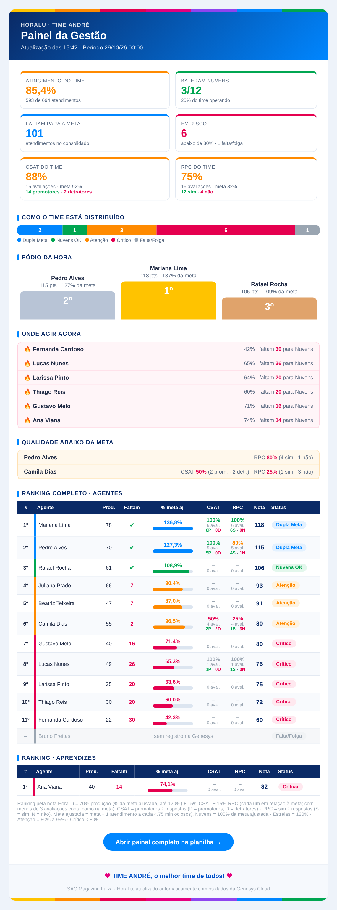
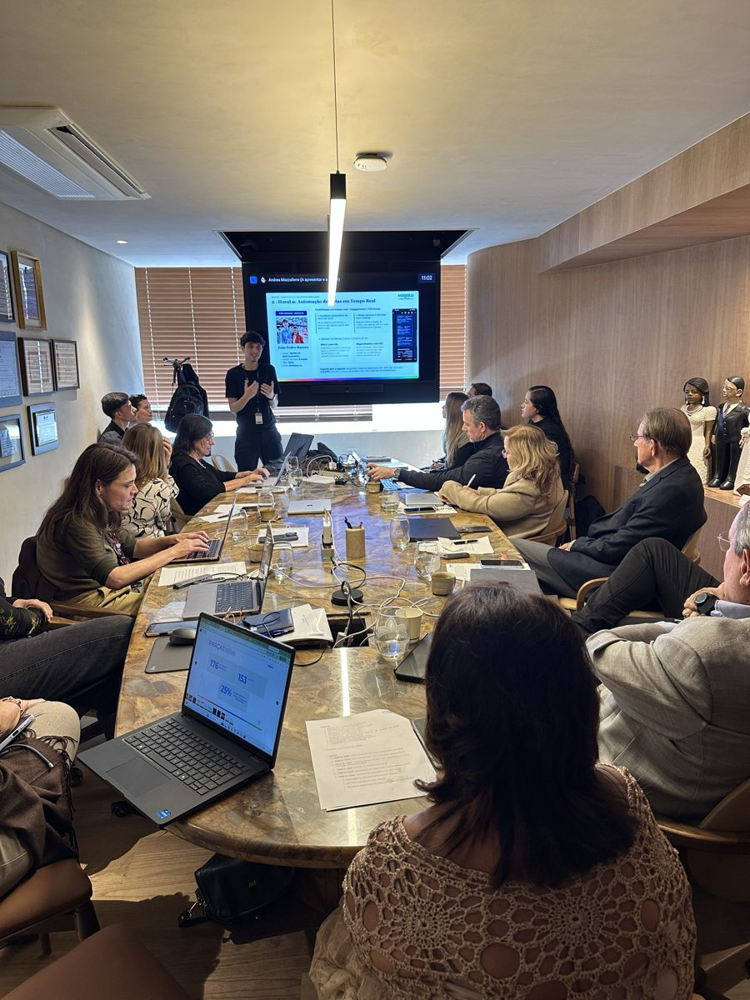
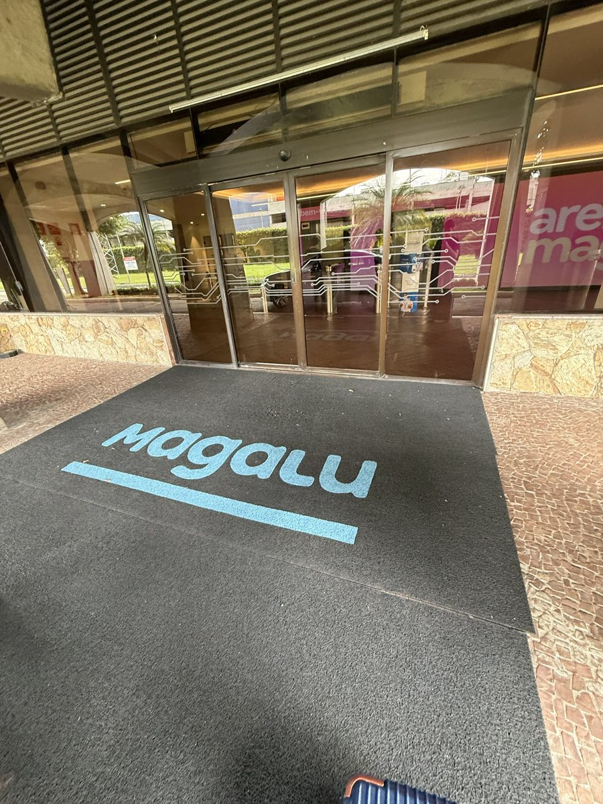
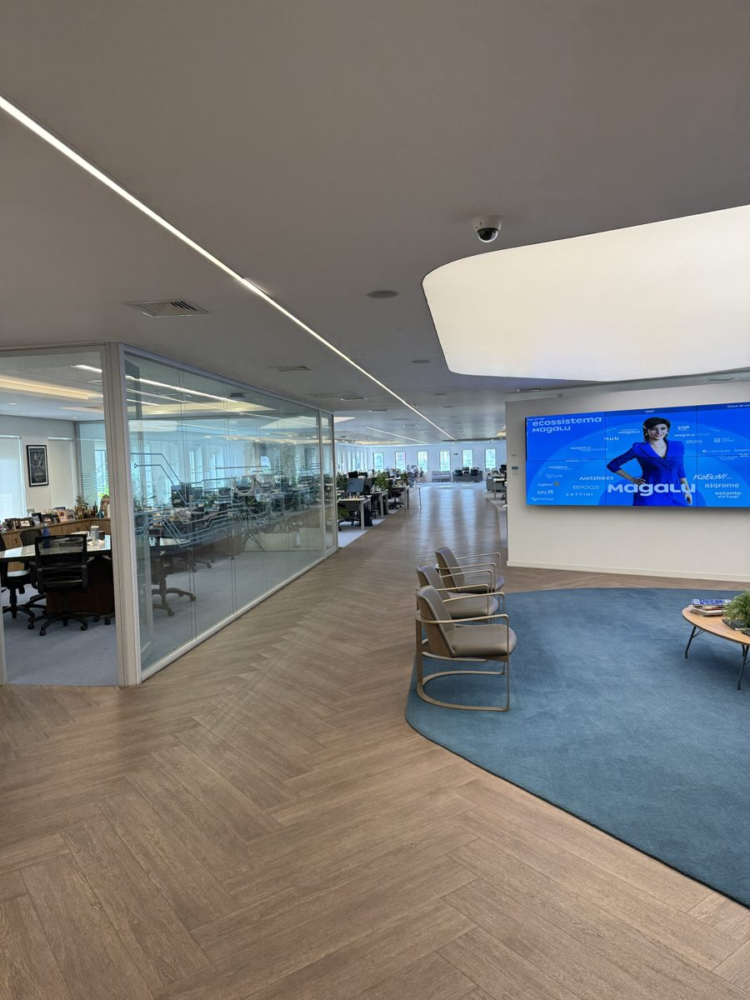
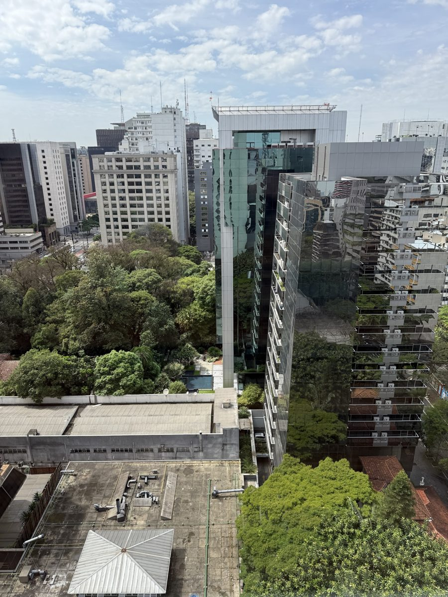
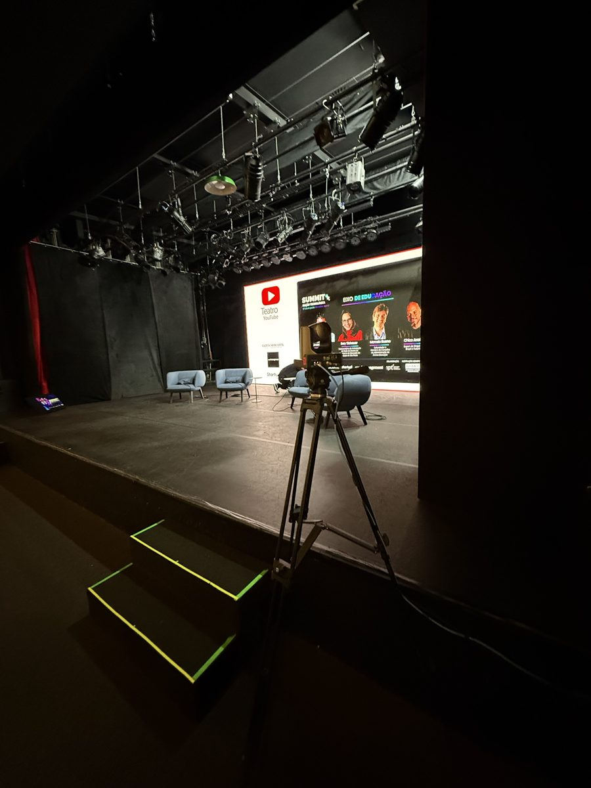

# HoraLu

Automação em **Google Apps Script** que lê os relatórios agendados da **Genesys Cloud** no Gmail, consolida as métricas numa planilha Google e envia, a cada atualização, e-mails com o desempenho do dia para os agentes e para a gestão do SAC.

> 🏆 **Projeto apresentado ao Conselho Corporativo do Magazine Luiza.**

O nome vem de "hora" + "Lu", de Magalu: o retorno chega ao longo do turno, e não só no fechamento do dia.

| Como o agente recebe | Como o gestor recebe |
|:---:|:---:|
|  |  |
| Só os próprios números. As posições do TOP 5 aparecem em cinza: o agente não vê nome, métricas nem metas dos colegas. | Painel completo do time: atingimento, pódio, quem precisa de ajuda, qualidade e ranking com todos os agentes. |

> As prévias usam dados fictícios.

## A história do projeto

O HoraLu foi criado por **João Racero**, Agente de Relacionamento no Pós-Vendas do Magazine Luiza (Magalu Resolve / SAC).

A ideia nasceu numa conversa de corredor com a supervisora, que tentava montar algo parecido sozinha com IA. O problema era o mesmo para todo mundo:

- ninguém via o próprio desempenho durante o dia, só no fechamento;
- a meta ajustada (descontando a ociosidade) era repassada à mão, pessoa por pessoa;
- os relatórios das equipes eram consolidados manualmente.

A pergunta que guiou o projeto foi simples: **como fazer cada agente saber, durante o turno, quanto falta para bater a meta?**

### Linha do tempo

| Quando | O que aconteceu |
|---|---|
| até mai/2026 | Atingimento médio do time em cerca de **99%**. |
| jun/2026 | Primeira versão em Google Apps Script para o time do supervisor Vitor: Meta Nuvens e Meta Estrelas, ranking TOP 5 / TOP 3 e e-mails de hora em hora. |
| jun–jul/2026 | Atingimento médio sobe para **112,14%**. |
| jul/2026 | João é eleito destaque do time no mês e apresenta a ideia para gerentes corporativos. |
| 2026 | Projeto apresentado no **Prêmio Destaque Operação Magalu 2026** e depois no **Arena Magalu**. |
| 2026 | **Apresentação ao Conselho Corporativo do Magazine Luiza.** |
| out/2026 | HoraLu levado ao time do supervisor André, sobre o script que ele já usava. Ganha CSAT, RPC e a Nota HoraLu. |
| nov/2026 | Código reorganizado e publicado neste repositório. |

### Resultados

- Atingimento médio do time: **~99% (abr–mai) → 112,14% (jun–jul)** depois da implantação.
- Cada agente passa a saber, várias vezes por dia, quanto falta para a meta e onde está no ranking.
- A gestão recebe o consolidado pronto, sem montar relatório à mão.
- Reconhecimento: destaque do time em jul/2026, Prêmio Destaque Operação Magalu 2026 e **apresentação ao Conselho Corporativo do Magazine Luiza**.
- **Custo zero**: roda inteiro em Google Workspace, sem servidor.

### Momentos

  
   <em><strong>Apresentação do HoraLu para o Conselho Corporativo do Magazine Luiza.</strong></em>

| | | |
|:---:|:---:|:---:|
|  |  |  |
| Chegada à Magalu | Escritório da Magalu | Vista da Av. Paulista |

  
   <em>Palco do Teatro YouTube</em>

## Como funciona

1. A Genesys envia por e-mail os relatórios em CSV (performance, ociosidade e avaliações).
2. Um gatilho do Apps Script procura esses anexos no Gmail, identifica cada CSV pelo cabeçalho e importa para as abas `RAW_*` da planilha.
3. O script calcula, por agente: produção, meta ajustada pela ociosidade, % da meta, CSAT, RPC e a **Nota HoraLu**, que ordena o ranking.
4. Envia os e-mails em HTML (CSS inline, para funcionar em qualquer cliente de e-mail):
   - **Agente**: as próprias metas (Meta Nuvens = 100% da meta ajustada, Meta Estrelas = 120%), sua posição e quanto falta para subir no TOP 5.
   - **Aprendiz**: mesma ideia, com ranking TOP 3 entre aprendizes.
   - **Gestão**: painel completo do time (atingimento, pódio, quem precisa de ajuda, qualidade, ranking completo).

Um **modo teste** gera todos os e-mails, mas manda tudo só para o gestor, com o assunto "[TESTE VISÃO AGENTE] Como chegará para: <nome>".

Regra de privacidade: o e-mail de agente e aprendiz **não traz nome, métricas nem metas dos colegas**. O placar mostra só as posições; os dados dos outros nem entram no HTML. Só a gestão vê tudo.

### Nota HoraLu

`70% produção (% da meta ajustada, limitada a 120%) + 15% CSAT ÷ meta + 15% RPC ÷ meta`

- CSAT = promotores ÷ respostas (meta 92%)
- RPC = "sim" ÷ respostas (meta 82%)
- Com menos de 3 avaliações, o indicador conta como na meta.

### Tecnologias

Genesys Cloud (relatórios agendados), Gmail, Google Sheets e Google Apps Script (`GmailApp`, `SpreadsheetApp`, `Utilities.parseCsv`, `PropertiesService`, `LockService` e gatilhos de tempo).

## Estrutura

| Pasta | Conteúdo |
|---|---|
| [`time-andre/`](time-andre/) | Versão atual (time do supervisor André): [`HoraLu_Andre.gs`](time-andre/HoraLu_Andre.gs), [passo a passo de implantação](time-andre/IMPLANTACAO.md) e [prévias dos e-mails](time-andre/previas/). Equipe na aba `AGENTES` e configuração no bloco `CFG`. |
| [`time-vitor/`](time-vitor/) | [Versão original](time-vitor/HoraLu_Vitor_original.gs) do HoraLu, criada para o time do supervisor Vitor. Equipe fixa no código e ranking por produção absoluta. |

## Instalação rápida (versão do time André)

1. Na planilha: **Extensões > Apps Script**, cole o conteúdo de `time-andre/HoraLu_Andre.gs` e salve.
2. No bloco `CFG` no topo do código, preencha `EMAIL_GESTOR`, `EMAIL_COORDENADORA` e `EMAIL_TESTE` (no repositório estão como `@exemplo.com.br`).
3. Na aba `AGENTES`, confira os e-mails dos agentes (coluna G) e marque `OK` (coluna H).
4. Recarregue a planilha e use o menu **HoraLu** para processar, testar e instalar o gatilho.

Detalhes completos em [`time-andre/IMPLANTACAO.md`](time-andre/IMPLANTACAO.md).

### Planilha esperada

Abas: `BASE_CONSOLIDADA`, `AGENTES`, `CONFIGURAÇÕES`, `RANKING`, `Dashboard`, `RAW_PERFORMANCE`, `RAW_OCIOSIDADE`, `RAW_AVALIACOES`, `CONSOLIDADO_AVALIACOES`, `HISTÓRICO` e `LOG` (criada automaticamente).

## Observações

- O gatilho precisa ser instalado na conta Google que **recebe** os relatórios da Genesys, porque o script lê o Gmail de quem o executa.
- Para levar o HoraLu a outro supervisor, use a versão do time André como base: crie os relatórios agendados na Genesys (performance, ociosidade e avaliações) para o Gmail da conta que roda o script, preencha o `CFG`, monte a aba `AGENTES`, rode o modo teste e só depois ligue os envios.
- Nunca coloque senhas no código. O script usa a própria conta Google para ler o Gmail e enviar os e-mails, então não precisa de nenhuma.
- Nenhum e-mail real, ID de planilha ou credencial está neste repositório. Os endereços foram trocados por exemplos.

## Próximos passos

- Unificar as versões Vitor e André numa versão única configurável.
- Disponibilizar um modelo de planilha para copiar.
- Acompanhar a cota de envio do Gmail se o time crescer.

## Autor

**João Racero** · [GitHub](https://github.com/JoaoRacero0805)

> *"Fazer o extraordinário no ordinário."* (Santa Teresinha)
